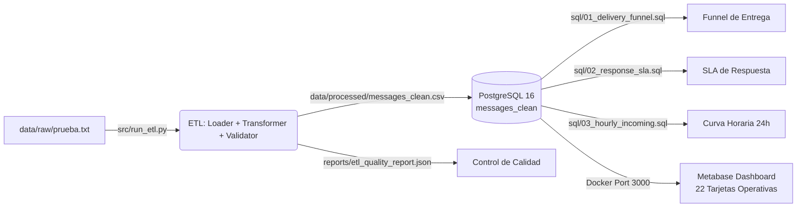

# 📊 Solución Integral — Prueba Técnica: Analista de Datos (BPO WhatsApp)

Solución técnica y analítica de punta a punta para el análisis y optimización operativa de campañas de mensajería masiva por WhatsApp en un entorno de Contact Center / BPO.

El proyecto abarca desde la ingesta y saneamiento de datos crudos (ETL con Python), diseño y modelado de base de datos relacional (PostgreSQL en Docker), consultas SQL avanzadas para funnels y SLA de respuesta (Window Functions), hasta visualización ejecutiva (Metabase), análisis diagnóstico de negocio y propuesta de arquitectura escalable FinOps.

---

## 📑 Tabla de Contenidos
1. [Resumen Ejecutivo & Métricas Clave](#-resumen-ejecutivo--métricas-clave)
2. [Resultados Golden (Reconciliación Global)](#-resultados-golden-reconciliación-global)
3. [Arquitectura de la Solución](#-arquitectura-de-la-solución)
4. [Estructura del Repositorio](#-estructura-del-repositorio)
5. [Requisitos Previos](#-requisitos-previos)
6. [Guía de Reproducción Rápida](#-guía-de-reproducción-rápida)
7. [Consultas SQL & Modelado](#-consultas-sql--modelado)
8. [Clasificación de Mensajes (NLP por Reglas)](#-clasificación-de-mensajes-nlp-por-reglas)
9. [Diagnóstico de Negocio & Hallazgos](#-diagnóstico-de-negocio--hallazgos)
10. [Escalabilidad & Estrategia FinOps](#-escalabilidad--estrategia-finops)
11. [Buenas Prácticas & Seguridad](#-buenas-prácticas--seguridad)

---

## 🚀 Resumen Ejecutivo & Métricas Clave

| Capa | Componente | Descripción | Estado de Verificación |
|---|---|---|:---:|
| **ETL & Data Quality** | Python 3.10+ / Pandas | Limpieza, parseo de JSONs y derivación temporal sobre 3.687 registros crudos pipe-delimited. | ✅ 100% filas conservadas (0 pérdidas), 11/11 tests pytest |
| **Data Warehouse** | PostgreSQL 16 (Docker) | Esquema optimizado con clave primaria e índices para acelerar cruces temporales. | ✅ DDL validado, consultas <13 ms |
| **SQL Analytics** | SQL (Window Functions & CTEs) | Funnel de entrega saliente, SLA de primera respuesta por conversación y curva horaria 24h. | ✅ 100% reconciliado contra Python |
| **Dashboard Operativo** | Metabase v0.51.8 | Visualización de 22 tarjetas, KPIs de campaña, tiempos de respuesta y filtros interactivos. | ✅ Métricas validadas vía API |
| **Business Insights** | Diagnóstico & Auditoría | Identificación de causas raíz de fallo masivo y concentración de demanda horaria. | ✅ Documentado en `reports/` |
| **Escalabilidad** | FinOps & Materialized Views | Estrategia de caching y vistas materializadas para 50 supervisores consultando cada 5 min. | ✅ Documentado en `docs/` |

---

## 🎯 Resultados Golden (Reconciliación Global)

Todas las métricas fueron auditadas y coinciden al 100% entre la capa de extracción en Python, la capa analítica en PostgreSQL y las tarjetas del Dashboard:

```
Total Registros Procesados: 3.687 (100% integridad, 0 duplicados, 0 pérdidas)
├── Outgoing (Salientes): 2.507 (67,99%)
│   ├── Failed:     1.396 (55,68%)  <-- 98,42% concentrado en Error #132000
│   ├── Read:         708 (28,24%)
│   ├── Sent:         320 (12,76%)
│   └── Delivered:     83  (3,31%)
├── Activity (Internos):    750 (20,34%)
└── Incoming (Entrantes):   430 (11,66%)
    ├── Respondidos:        369 (85,81%)
    └── Sin Respuesta:       61 (14,19%)
```

### Métricas de Rendimiento Operativo (SLA)
- **SLA Promedio:** `127,24 minutos` (sesgado por outliers de hasta 44 horas).
- **SLA Mediana:** `0,68 minutos` (~41 segundos, demostrando alta agilidad en la mayoría de casos).
- **SLA Percentil 95 (P95):** `1.152,68 minutos` (~19,2 horas).
- **Cobertura de Plantillas en Outgoing:** `65,42%` (1.640 con template, 867 sin template).

---

## 🏗 Arquitectura de la Solución



1. **Loader (`src/etl/loader.py`):** Ingesta segura delimitada por pipes (`|`), respetando comillas en campos JSON y evitando desbordamientos de columnas.
2. **Transformer (`src/etl/transformer.py`):** Normalización de timestamps sin zona horaria, desanidado de atributos JSON (`content_attributes`, `additional_attributes`), extracción de nombres de plantillas, derivación de `date`, `hour`, `day_of_week` y clasificación temática por palabras clave.
3. **Validator (`src/etl/validator.py`):** Reglas de calidad automatizadas (comprobación de claves primarias únicas, no nulidad de `id` y `conversation_id`, validación sintáctica de JSON y consistencia de categorías).
4. **PostgreSQL & Índices (`sql/schema.sql`):** Estructura relacional con índices compuestos sobre `(conversation_id, created_at, id)` y `(message_type, status)` para garantizar ejecución en milisegundos.

---

## 📁 Estructura del Repositorio

```
.
├── .env.example                       # Plantilla de variables de entorno para desarrollo local
├── .gitignore                          # Exclusión de archivos sensibles (.env), caches y venv
├── docker-compose.yml                  # Servicios orquestados: PostgreSQL 16 + Metabase v0.51.8
├── requirements.txt                    # Dependencias Python (pandas, pytest, psycopg2-binary)
├── README.md                           # Documentación técnica principal
│
├── data/
│   ├── raw/
│   │   └── prueba.txt                  # Dataset crudo original (pipe-delimited, 3.687 registros)
│   └── processed/
│       └── messages_clean.csv          # Dataset normalizado y enriquecido listo para SQL
│
├── docs/
│   ├── dashboard.md                    # Arquitectura, preguntas, KPIs y variables del dashboard
│   └── scalability_finops.md           # Estrategia FinOps para 50 supervisores (cero sobrecosto)
│
├── reports/
│   ├── business_analysis.md            # Diagnóstico de negocio, análisis de causas raíz y acciones
│   ├── etl_quality_report.json         # Certificado de calidad y reconciliación de datos del ETL
│   ├── pre_sql_analysis.json           # Perfilado estadístico previo generado en Python
│   ├── sql_validation_report.json      # Reporte de ejecución y tiempos EXPLAIN ANALYZE en Postgres
│   ├── metabase_dashboard_validation.json # Validación de tarjetas y filtros vía API de Metabase
│   ├── final_audit.md                  # Auditoría integral pre-entrega
│   └── *.csv                           # Tablas analíticas auxiliares generadas durante el perfilado
│
├── scripts/
│   └── validate_sql_results.py         # Carga datos en PostgreSQL y audita las consultas vs Golden
│
├── sql/
│   ├── schema.sql                      # DDL de messages_clean e índices optimizados
│   ├── consultas.sql                   # Archivo consolidado con las tres consultas de negocio
│   ├── 01_delivery_funnel.sql          # Consulta 1: Funnel de entrega outgoing con porcentajes
│   ├── 02_response_sla.sql             # Consulta 2: SLA de primera respuesta posterior (Window Func)
│   ├── 02_response_sla_explanation.md  # Fundamentación técnica del orden determinista en el SLA
│   ├── 03_hourly_incoming.sql          # Consulta 3: Demanda horaria de 24h con generate_series
│   └── golden_results_validation.md    # Resultados esperados y plan de prueba
│
├── src/
│   ├── etl/
│   │   ├── __init__.py
│   │   ├── loader.py                   # Ingesta robusta de datos con manejo de separadores
│   │   ├── transformer.py              # Limpieza, extracción JSON y motor NLP de clasificación
│   │   └── validator.py                # Reglas de integridad y reconciliación cuantitativa
│   ├── run_etl.py                      # Script principal que orquesta la ejecución del ETL
│   └── profile_dataset.py              # Script generador de perfiles estadísticos y golden benchmarks
│
└── tests/
    └── test_etl.py                     # Suite de 11 pruebas unitarias y de integración (pytest)
```

---

## ⚙️ Requisitos Previos

- **Python:** 3.10 o superior.
- **Docker & Docker Compose:** Docker Desktop (para PostgreSQL y Metabase).
- **Git:** Para clonar y versionar el repositorio.

---

## 🚀 Guía de Reproducción Rápida

### 1. Clonar el repositorio y preparar el entorno
```bash
git clone https://github.com/SantiagoMaciasRuiz/prueba-tecnica-bpo-whatsapp.git
cd prueba-tecnica-bpo-whatsapp
python -m venv venv

# En Windows:
.\venv\Scripts\activate
# En Linux/macOS:
source venv/bin/activate

pip install -r requirements.txt
```

### 2. Configurar variables de entorno
```bash
# Windows
copy .env.example .env

# Linux/macOS
cp .env.example .env
```
> El archivo `.env.example` contiene credenciales locales preconfiguradas para desarrollo y conexión directa con el `docker-compose.yml`.

### 3. Ejecutar el pipeline ETL
```bash
python src/run_etl.py
```
*Salida generada:*
- `data/processed/messages_clean.csv`
- `reports/etl_quality_report.json` con `is_valid: true`.

### 4. Ejecutar la suite de pruebas unitarias
```bash
python -m pytest -v
```
*Resultado:* **11 passed in ~22s** (valida loader, parser de JSONs malformados, fechas, categorías NLP y reconciliación de filas).

### 5. Generar perfilado estadístico de referencia
```bash
python src/profile_dataset.py
```
Genera `reports/pre_sql_analysis.json` y los resúmenes tabulares en `reports/`.

### 6. Levantar la infraestructura en Docker (Opcional para DB y BI)
```bash
docker compose up -d --wait
```
- **PostgreSQL 16:** Puerto `5433` (evita conflicto con instalaciones locales en el puerto estándar 5432).
- **Metabase v0.51.8:** `http://localhost:3000`

### 7. Validar consultas SQL en PostgreSQL
```bash
python scripts/validate_sql_results.py
```
Este script recrea la tabla en PostgreSQL, ejecuta `COPY FROM STDIN` con `messages_clean.csv`, corre `01_delivery_funnel.sql`, `02_response_sla.sql` y `03_hourly_incoming.sql` con `EXPLAIN (ANALYZE, BUFFERS)` y valida las cifras contra los Golden Results.

---

## 🔍 Consultas SQL & Modelado

### Esquema e Indexación Estratégica (`sql/schema.sql`)
La tabla `messages_clean` preserva los identificadores originales como `text` para evitar pérdida de ceros a la izquierda o truncamientos. Se diseñaron 3 índices que reducen drásticamente los costos de lectura:
1. `idx_messages_conversation_created_id`: Optimiza el cálculo de SLA al realizar saltos directos sobre la conversación y su cronología.
2. `idx_messages_type_status`: Acelera los filtros del funnel y métricas de campaña.
3. `idx_messages_created_at`: Permite agregaciones rápidas por rangos de fechas y horas.

### 1. Funnel de Entrega Outgoing (`sql/01_delivery_funnel.sql`)
- **Técnica:** CTE filtrada + `CROSS JOIN` con total saliente.
- **Rendimiento:** ~3,67 ms.
- **Resultado:**
  - `failed`: 1.396 (55,68%)
  - `read`: 708 (28,24%)
  - `sent`: 320 (12,76%)
  - `delivered`: 83 (3,31%)

### 2. SLA de Primera Respuesta Posterior (`sql/02_response_sla.sql`)
- **Técnica:** `ROW_NUMBER() OVER (PARTITION BY i.id ORDER BY a.created_at, a.id)` sobre eventos posteriores de tipo `activity` u `outgoing`.
- **Rendimiento:** ~12,45 ms.
- **Detalle de Diseño:** Maneja desempate determinista con `a.id > i.id` en caso de timestamps idénticos. Permite que acciones posteriores fuera de un rango de fecha no queden invisibilizadas.
- **Resultado:**
  - 430 incoming, 369 respondidos (85,81%), 61 sin respuesta (14,19%).
  - Promedio: 127,24 min | Mediana: 0,68 min | P95: 1.152,68 min.

### 3. Curva de Demanda Horaria (`sql/03_hourly_incoming.sql`)
- **Técnica:** `generate_series(0, 23)` + `LEFT JOIN` para asegurar que las 24 horas del día aparezcan en el resultado, incluso aquellas con 0 mensajes entrantes.
- **Rendimiento:** ~1,52 ms.
- **Concentración:** El 87,4% de los mensajes entrantes se agrupan entre las **12:00 y las 23:00**, con picos notables a las **15:00 (83 incoming)** y **16:00 (65 incoming)**.

---

## 🧠 Clasificación de Mensajes (NLP por Reglas)

Implementada en `src/etl/transformer.py`, aplicada exclusivamente sobre mensajes entrantes (`incoming`):
1. **Normalización Lingüística:** Conversión a minúsculas, descomposición Unicode NFD para remoción de tildes/acentos y normalización de espacios en blanco.
2. **Prioridad y Reglas Semánticas:**
   - **Queja:** `no me llego`, `cobro`, `rechaz`, `inconforme`, `problema`, `fallo`, `queja`, `error`, `faltante`.
   - **Soporte:** `ayuda`, `asesor`, `servicio al cliente`, `inquietud`, `consulta`, `informacion`, `como puedo`.
   - **Pedido:** `catalogo`, `pasar pedido`, `hacer pedido`, `montar pedido`, `ingresar.*pedido`, `comprar`.
   - **Otros:** Mensajes no clasificados en las anteriores.

**Distribución de Categorías en Mensajes Entrantes:**
- `Otros`: 375 (87,21%) — Saludos genéricos, confirmaciones simples o emojis.
- `Soporte`: 22 (5,12%)
- `Pedido`: 21 (4,88%)
- `Queja`: 12 (2,79%)

---

## 📈 Diagnóstico de Negocio & Hallazgos

El análisis detallado se encuentra en [`reports/business_analysis.md`](reports/business_analysis.md). Principales conclusiones:

1. **El 55,68% de los mensajes salientes falla:**
   - El 98,42% de los fallos (1.374 de 1.396) se deben al error `(#132000) Number of parameters does not match the expected number of params`.
   - El cruce por plantilla evidencia que la plantilla `lanzamiento_` tuvo un **100% de tasa de fallo (1.352 intentos fallidos)**.
   - **Acción Inmediata:** Corregir el mapeo de variables/parámetros en el backend antes de reanudar envíos con esa plantilla.
2. **Excelente agilidad operativa en horario hábil:**
   - La mediana de respuesta es de solo **41 segundos (0,68 min)**, indicando que cuando un asesor o bot está activo, la interacción es casi inmediata.
   - La brecha entre promedio (127 min) y mediana se explica por mensajes recibidos fuera de jornada laboral que esperaron hasta la mañana siguiente para ser atendidos.
3. **Distribución del personal operativo:**
   - La demanda es prácticamente nula de 00:00 a 11:00 y se activa fuertemente en la tarde. Los turnos de agentes deben concentrarse a partir de las 13:00 con refuerzo entre 15:00 y 17:00.

---

## 💡 Escalabilidad & Estrategia FinOps

Documentado a fondo en [`docs/scalability_finops.md`](docs/scalability_finops.md). Para atender la concurrencia de **50 supervisores consultando el dashboard cada 5 minutos (600 consultas/hora)** sin incurrir en sobrecostos de infraestructura Cloud:

1. **Caché en Metabase (TTL = 300s):**
   - Configurar la retención de consultas en 5 minutos. Los 50 usuarios leen de memoria RAM en el servidor de BI.
   - **Impacto:** Reduce las ejecuciones contra la base de datos de 600/hora a solo 12/hora (**98% de ahorro en CPU de DB**).
2. **Vista Materializada para SLA (`mv_response_sla`):**
   - Precalcular el emparejamiento de mensajes una vez cada 5 minutos mediante `REFRESH MATERIALIZED VIEW CONCURRENTLY`.
   - Las consultas de los supervisores se convierten en lecturas secuenciales ultrarrápidas de una tabla ya indexada.
3. **Connection Pooling:**
   - Limitar el pool de conexiones en PostgreSQL a 15 conexiones activas concurrentes para eliminar la sobrecarga de context switching.

---

## 🔒 Buenas Prácticas & Seguridad

- **Variables de Entorno:** Ninguna credencial productiva está commiteada. El archivo `.env` está en `.gitignore` y solo se expone `.env.example` para pruebas locales.
- **Idempotencia:** Scripts de ETL y SQL diseñados para ejecutarse múltiples veces sin generar estados inconsistentes ni duplicación de registros.
- **Auditoría Completa:** Consulte [`reports/final_audit.md`](reports/final_audit.md) para revisar el informe completo de validación pre-entrega.
